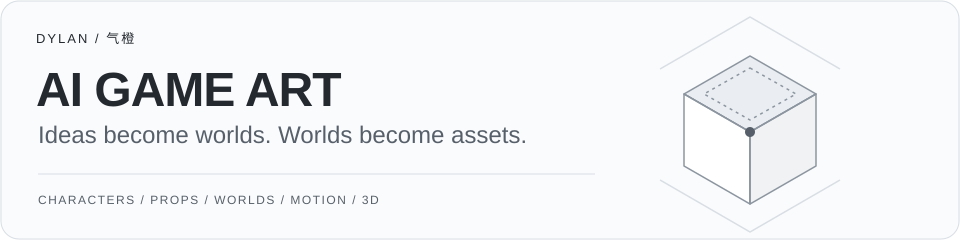
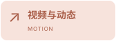
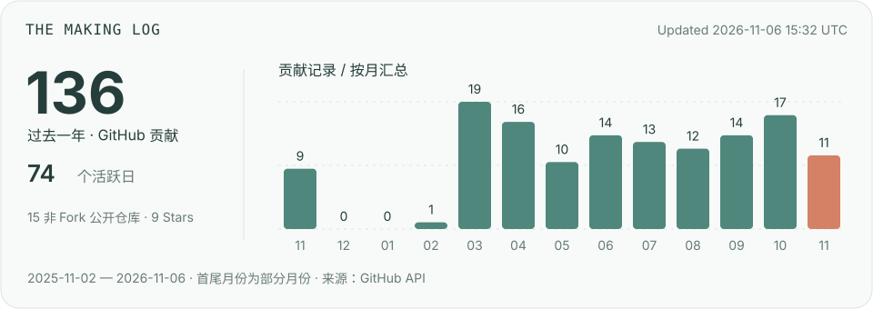

  

**我是 Dylan / 气橙，产品经理与创作者。** 关注一个游戏创意，如何长出有联系的角色、道具、场景与动态表现。

  
  
  
  
  

[正在探索](#on-the-desk) &nbsp; / &nbsp; [打开工作台](#explore) &nbsp; / &nbsp; [创作轨迹](#making-log) &nbsp; / &nbsp; [交流](#connect)

## ✦ 正在探索 On the desk

- **让角色有来处。** 从世界设定和玩家行为，推导角色身份、服装与随身工具。
- **让资产说同一种语言。** 将轮廓、材质与视觉符号，延伸到道具、图标和场景模块。
- **让画面发生变化。** 探索动作、镜头、空间与反馈，怎样把静态设定变成可理解的体验。

> **作品与实验整理中。** 将围绕具体游戏主题，呈现从世界设定到资产应用的完整过程。

↳ 一个案例会怎样展开

**世界与玩法 → 角色与资产 → 场景与动态 → 取舍与迭代**

每个案例标明实际参与内容和完成状态；概念图、静态分镜、模型与可运行项目分别说明。同步整理创作中用到的 AI 工作流、Skills 与实践笔记。

## ↗ 打开工作台 Explore

**[公开项目](https://github.com/QiOrange-qior?tab=repositories&type=source)**  
浏览已有的代码、工具与实验。

**[灵感收藏](https://github.com/QiOrange-qior?tab=stars)**  
看看我关注的开源项目与工具。

## ◷ 创作轨迹 The making log

GitHub 活动按月汇总，每日更新；首尾月份可能不完整。数据反映 GitHub API 可见的贡献记录，不代表全部创作活动。 [更新状态](https://github.com/QiOrange-qior/QiOrange-qior/actions/workflows/profile-dashboard.yml)

---

**一起聊聊，怎样让一个创意长成一个世界。**  
AI 游戏美术 · 创意素材 · 视频与 3D · 创作工具与产品

[在 GitHub 找到我 ↗](https://github.com/QiOrange-qior)

Dylan / 气橙 · Imagine. Design. Make it play.
